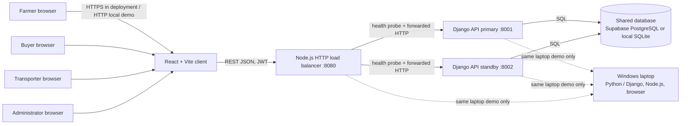

# AgriConnect: Fault-Tolerant Distributed Service

**Course:** BSE 4103 / BCS 3107 — Distributed Systems  
**Faculty:** Faculty of Science and Computing  
**Project context:** Uganda farm-to-market produce exchange  
**Report status:** Prototype implementation and tests; group members should add their names and individual contribution evidence before submission.

## Abstract

AgriConnect is a small distributed service for farmers, produce buyers,
transporters, and administrators. Its browser client communicates over HTTP
with a local Node.js reverse proxy, which selects between two Django REST API
processes. The API processes share one database, so application state is not
stored in either server process. Database transactions and conditional updates
coordinate competing purchases and delivery claims. A readiness check lets the
proxy route around a failed API process and explicitly report when no process
is ready. Tests cover permissions, health reporting, stock conflicts, and
transporter claims. A 100-request benchmark was run at two client
concurrency levels on one laptop. This is a teaching prototype, not a
production high-availability deployment: it has a single database, a
single-machine proxy, and no durable queue for requests during outages.

## 1. Requirements and architecture

### 1.1 Users and requirements

| User | Main responsibilities |
|---|---|
| Farmer | Publish produce, review purchase requests, accept or reject requests, update order status. |
| Buyer | Browse and filter produce, submit purchase requests, pay using the prototype's payment-state flow, and track orders. |
| Transporter | Find open deliveries, claim a job, and submit pickup, transit, delivery, and checkpoint updates. |
| Administrator | Review user verification, moderate listings, and inspect country-wide orders and deliveries. |

The backend enforces roles; hiding a button in the browser is not the
authorization boundary. Public registration accepts farmer, buyer, and
transporter roles. Administrator accounts must be provisioned by an existing
administrator or using Django's createsuperuser command.

The core functional requirements are:

1. Authenticated users can create, retrieve, and update records appropriate to
   their role.
2. Buyers can discover active listings and request available quantities;
   farmers can turn accepted requests into orders.
3. Transporters can claim an open delivery and report its progress; buyers and
   sellers can track it.
4. Administrators can verify users and oversee marketplace and delivery
   records.
5. If one API process fails, the proxy can serve requests through another
   healthy process; if none is healthy, it returns an explicit unavailable
   response.

### 1.2 Labelled architecture



**Figure 1.** One browser-facing service address hides two API processes. The
proxy probes `/api/v1/health/`; the API health response is ready only when a
`SELECT 1` succeeds against the configured default database. Both API nodes
must use the same database. The laptop arrangement demonstrates process
failover, not machine or network-path redundancy. In a real deployment the
components would be placed on separate hosts, protected by TLS, and connected
to a managed highly available database.

The React/Vite client uses REST/JSON and JWT bearer tokens. The proxy uses
HTTP between services, checks each backend about once per second, prefers the
first configured healthy backend, and adds an `X-AgriConnect-Upstream` response
header. API health and proxy health can be checked at
`/api/v1/health/` and `/__lb/health`, respectively.

## 2. Implementation and roles

The browser application provides a role-specific dashboard after sign-in.
Farmers create listings and handle buyer requests; buyers search produce and
submit a request for a selected quantity; acceptance creates an order and,
when requested, a delivery. A buyer can select a preferred transporter.
Transporters progress the delivery through accepted, picked-up, in-transit,
and delivered states. Administrators review registrations and listings and
view aggregate order and delivery information. These are prototype business
flows: payment is represented by application status and is not a connection
to a payment provider.

The API is implemented with Django REST Framework. Its role checks return
`403 Forbidden` for operations a signed-in role cannot perform. Public
registration is restricted to non-administrator roles so a client cannot
grant itself administrator access. The API provides health, authentication,
marketplace, order, delivery, notification, and administration endpoints.

The local demo requires Python and Node.js and does not require containers.
Install backend dependencies from `backend/requirements.txt`, initialize the
database with Django migrations, and seed demo records when desired. Start
`runserver` twice on ports 8001 and 8002 with distinct `AGRI_NODE_ID` values,
then run `npm run load-balancer` from `frontend`. The frontend runs with
`npm run dev`. Full Supabase configuration and startup instructions are in
[README.md](./README.md). For safe automated tests, the dedicated
`config.test_settings` module uses an in-memory SQLite database rather than
the configured cloud database.

## 3. Coordination and consistency

The database is the shared source of truth; API nodes do not keep independent
authoritative copies. For a farmer accepting a buyer request, the backend
opens a transaction, locks the request row with `select_for_update`, verifies
that the request is still pending, and conditionally decrements listing stock
with a database-side `quantity_available >= requested_quantity` predicate and
an `F()` expression. If another accepted request has consumed the stock, the
second acceptance is cancelled and returns HTTP 409 instead of overselling.
The order, request status, notifications, and event record are written as part
of the same transaction flow.

Delivery claiming uses a compare-and-set update: only an `open` delivery can
change to `accepted` and acquire a transporter. The update count determines
the winner; a later competing claim receives HTTP 409. This avoids relying on
an application server's in-memory lock, which would not coordinate multiple
processes. Order status transitions use a row lock and an explicit allow-list
of valid state changes. These mechanisms rely on the configured database's
transaction semantics; the shared PostgreSQL configuration is the intended
multi-process database. SQLite is useful for a laptop demonstration but has
different locking and multi-host limitations.

Automated API tests create competing requests against five units of stock and
verify that only one four-unit order can be accepted. A second test attempts
to assign the same delivery to two transporters and verifies that the first
claim is retained and the second rejected. These tests exercise stale,
conflicting updates; they are deterministic sequential API attempts, not a
claim that a distributed multi-machine race benchmark has been run.

## 4. Fault handling and reliability

Each Django node has a readiness endpoint that checks its database connection.
The proxy only routes to ready nodes, prefers the primary when available,
fails over to the standby when the primary is stopped, and returns to the
primary when it recovers. It retries another backend only if a connection is
refused before the request reaches that backend; it does not replay a request
after a response may have been produced. That avoids duplicate writes at the
cost of returning an error for some ambiguous mid-request failures.

The demonstrated failure sequence was: both nodes ready; stop the primary and
observe the standby serving a health request; stop both nodes and observe HTTP
503; then query the cloud database directly and receive `SELECT 1 = 1`.
Therefore the database remains usable by other clients during a complete API
outage, but the database alone does **not** serve this web application. There
is no automatic API restart or offline request queue.

The cloud database is a single configured dependency. If it is unavailable,
both API readiness checks fail and the proxy returns 503. The optional local
SQLite database is not a synchronized replica and must not be treated as
automatic database failover. Configure and test Supabase backups, point-in-time
recovery, and provider high availability separately. The proxy itself is also
a single point of failure in this local topology.

## 5. Performance evaluation

### 5.1 Method

The standard-library benchmark `backend/load_test.py` sent 100 read-only
requests to the load-balanced API health endpoint for each test case. The
endpoint returns only after a database readiness query. Test cases used one
worker and ten concurrent workers. Both Django processes and the Node proxy
ran on the same laptop. The benchmark used a separate shared local SQLite
database through `config.local_performance_settings`; it did not use the cloud
database or modify production data. Measurements are wall-clock client
latencies, include proxy and API overhead, and are specific to this machine.

**Machine/software:** Windows 11 (build 26100), Intel Core i5-7300U at 2.60
GHz, 8 GB RAM, Python 3.13.7, Node.js v24.14.1. The Django development server
was used, not a production ASGI/WSGI server.

### 5.2 Results

| Requests | Concurrent clients | Successful | Failed | Mean latency | P50 | P95 | Maximum | Throughput |
|---:|---:|---:|---:|---:|---:|---:|---:|---:|
| 100 | 1 | 100 (100%) | 0 | 10.90 ms | 9.58 ms | 15.98 ms | 97.72 ms | 90.65 req/s |
| 100 | 10 | 100 (100%) | 0 | 55.32 ms | 48.94 ms | 114.86 ms | 233.82 ms | 109.34 req/s |

Increasing concurrency from one to ten raised average and tail latency, while
raising aggregate throughput from about 91 to 109 requests per second. The
local database and development server completed every request at both loads;
the ten-client throughput increase is less than tenfold because clients share
one laptop, one SQLite file, and one proxy. The observed maximum latency is
sensitive to operating-system scheduling and should not be treated as an SLA.
The benchmark measures read-only health traffic, not image uploads, writes,
order contention, internet latency, or production performance.

The configured Supabase database was separately verified with a successful
PostgreSQL `SELECT 1`, and API health checks reported database readiness.
An exploratory cloud-backed load attempt showed highly variable response
times and client timeouts, so those results are not mixed into the local
benchmark table. The cloud-backed load test should be repeated from the
deployment region with a larger controlled sample before drawing conclusions
about Supabase capacity.

## 6. Test evidence and demonstration plan

The isolated Django suite contains six tests: database-ready health, database
unavailable health, rejection of public administrator registration, role
authorization, competing purchase acceptance, and competing delivery claims.
Run it from `backend` with:

```powershell
..\.venv\Scripts\python.exe manage.py test agri.tests --settings=config.test_settings
```

The suite passed all six tests. The React production build also completed
successfully. For a short live demonstration (under 15 minutes):

1. **0–2 min:** show Figure 1 and start the frontend, proxy, and two API nodes.
2. **2–5 min:** sign in as a farmer to post produce, then as a buyer to submit a
   request; show the farmer accepting it.
3. **5–7 min:** sign in as the assigned transporter and update delivery
   progress; show the buyer's tracking view.
4. **7–10 min:** show that roles are enforced and demonstrate the
   administrator's verification and oversight screens.
5. **10–12 min:** stop the primary and show the standby serving requests; stop
   both nodes and show the explicit 503 response.
6. **12–14 min:** run the 1-client/10-client load test and explain its
   limitations.

| Group member | Contribution to identify and demonstrate |
|---|---|
| Member 1: __________________ | ______________________________ |
| Member 2: __________________ | ______________________________ |

Each member should demonstrate their own contribution in the recording.

## 7. Conclusion and limitations

AgriConnect demonstrates a multi-client REST service, role-specific user
workflows, two communicating API processes, shared-database consistency,
conflict handling, health-based failover, explicit outage responses, and a
measured load test. Its central reliability trade-off is clear: an API process
can fail without losing access to shared records, but a database or proxy
failure still interrupts the application. The local benchmark and development
servers are suitable for a classroom laptop prototype only. Production use
would require independently hosted API replicas, a managed highly available
database with tested recovery, TLS and restricted network access, production
server software, monitoring, rate limits, and a benchmark against realistic
read/write workloads.
